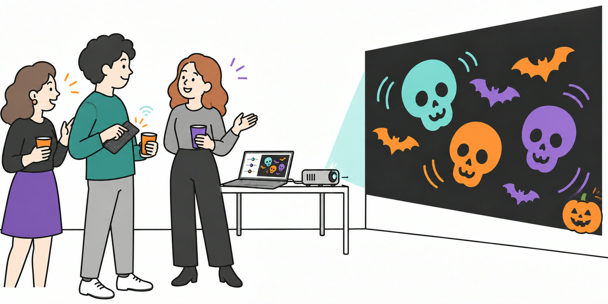
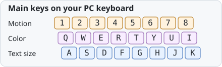
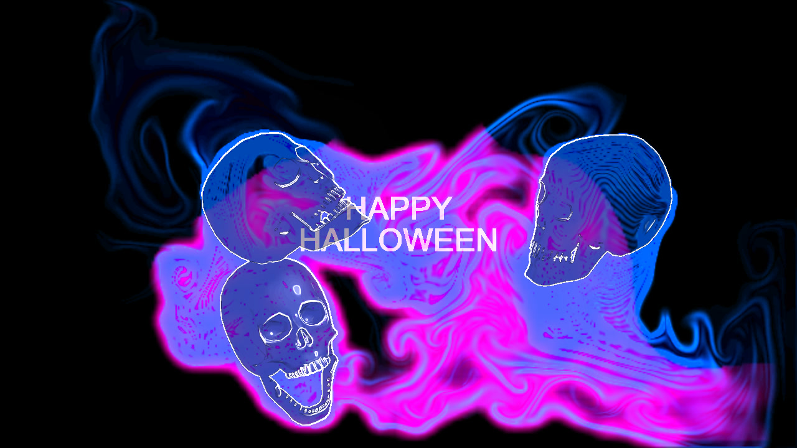

[日本語](README.md)

# Bring Halloween to walls and floors with your keyboard

*Using a keyboard to control the projection. This is an explanatory illustration; see the browser captures below for the actual visuals.*

- **Project skulls and bats** — turn walls and floors into a Halloween scene.
- **Change motion and color live** — use your keyboard to match the mood.
- **Add your own words** — put a greeting or event name into the visuals.

<!-- DEMO_VIDEO_URL: Add only a video verified as playable on GitHub. Never use a private Library URL or local path. -->
<!-- TD_PROJECTION_EXAMPLE: Label approved footage "Projection example made with the TouchDesigner version", distinct from browser captures. -->

## Try it

Download and start projecting in three steps

**The application ZIP is being prepared for release. There is no published Release or public download link yet.**

The verified package is named `halloween-projection-web-v0.1.55-jaw-edge-preview.zip`. Its download link will go here after publication.
<!-- RELEASE_DOWNLOAD_URL: After publishing an approved Release with the verified application ZIP attached, replace the notice above with its actual link. The automatic Source code ZIP is a different package. -->

### Start in three steps

Tested with **Windows and Chrome**. Prepare the projector connection and display arrangement in Windows first. No extra software or command-line setup is needed.

1. **Extract the entire ZIP.** Right-click it and choose **Extract All**. Keep the folder together.
2. **Open the entry page.** In Chrome, open `はじめに_START-HERE.html`, choose **English**, then **Start the projection**.
3. **Start the projection window.** Choose **Open projection window**, move that window to the projector display, and click **Start windowed** or **Start fullscreen**. Return to the console, prepare your text, then choose **Enable keys**.

Keep both windows open. Once extracted, the complete folder can run offline.

## Play from the keyboard

Use Latin keys without Shift while the console has focus.

| Key | Action |
| --- | --- |
| `1`–`8` | Choose one of eight motion intensities |
| `Q W E R T Y U I` | Choose a hue |
| `A S D F G H J K` | Choose a text size |
| `Z` | Switch skulls / bats |
| `X` | Cycle normal / horizontal flip / vertical flip / both |
| `L` / `M` | Choose jaw width / open or close the jaw |
| `Space` | Pause / resume the whole image |
| `Esc` | Disable performance keys; the image continues |

Edit the words in the console text box. `9` / `0` selects 1–6 skulls; `C` returns a manual jaw to automatic motion. The complete key guide is `アプリ本体/GUIDE.html` in the extracted package.

More controls, recovery and exit

- Text fields, IME and window changes disable performance keys. Return to the console and choose **Enable keys** again.
- If disconnected, choose **Reconnect to projection**. If the projection window was closed, open a new one.
- Hold `N` for 0.6 seconds to reset the simulation while retaining text and settings. Hold `B` for 0.6 seconds to restore a previously saved baseline.
- At 0% motion, skull heads return to rest; bats keep flapping. Use `Space` to pause everything.
- To finish, open **Output, stop & exit → End projection**. Closing the projection window resets text, settings and the baseline.
- The language switch changes UI text without translating your projected words.

## The browser visuals

Switch between skulls and bats.

*A browser demo capture, not a photograph of a physical projection.*

## Before projecting

Start with reduced projector brightness and a small window. Avoid directing the beam into people's eyes, and consider viewers sensitive to bright, rapidly changing imagery. Follow your projector's placement and ventilation instructions.

How dark the black background appears depends on the projector, surface and ambient light. Automatic display placement, keystone correction and phone control are not provided. Check physical projector setups and other computers before use.

## Pair it with a portable projection setup

A PC and projector on a table are enough for the standard setup. For travel, a suitcase, portable power supply, tripod and projector can form a portable setup for an outdoor party, band performance or Halloween event. A suitcase or dedicated portable kit is optional for this app.

Outdoor use depends on sufficient darkness, a suitable projection surface, venue permission and a safe place to secure the equipment and keep walking routes clear.

For the equipment and assembly, see [mamo's portable outdoor projector setup guide on Qiita (in Japanese)](https://qiita.com/moma42105016/items/85e66a60eb7b656c819c).

<!-- PORTABLE_SETUP_ILLUSTRATION: Add only after the separately prepared concept illustration is received and reviewed; portable equipment is optional. -->

## License and editing

The opening usage illustration was generated for this README. It is a separate asset from the third-party model and real projection photographs.

Own code, the owner-created bat artwork and sampled/validation values are **MIT licensed**. The third-party **CDmir / Human Skull** model retains **CC0 1.0**. See [LICENSE](LICENSE) and the [asset notices](web/RIGHTS.txt).

Edit the application or work from source

The ZIP contains editable HTML, CSS and JavaScript. In `アプリ本体/`, edit `console.html` / `console.css` for the console, `GUIDE.html` / `guide.css` for help, and `i18n.js` for UI translations. Ordinary text and style changes need an editor and reload.

Images are also embedded and hash-checked; replacing only the PNG is insufficient. See the [editing notes](web/README.txt) and [asset provenance](docs/PUBLIC-READINESS.md).

GitHub's **Code → Download ZIP** downloads the source repository, which has a different layout. Extract it and open its root `START-HERE.html`; normal use still needs no build. Packaging tools and historical validation records are developer material; `app/` is an older Windows prototype.

Current verification: [v55 release record](releases/v55.json). Earlier development notes remain under `docs/` and `releases/`.

