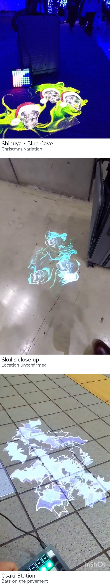

[日本語](README.md)

# Bring Halloween to walls and floors with your keyboard

Project skulls and bats onto walls or floors, and change motion, color and text with your keyboard.

**[Download the application ZIP](https://github.com/hiro-collab/halloween-projection/releases/download/v0.1.55/halloween-projection-web-v0.1.55-jaw-edge-preview.zip)** · Windows / Chrome. Extract All, then open `はじめに_START-HERE.html` in Chrome.

*The photos show projections made with the TouchDesigner version, adapted for each setting. You can use this app in the same way to project skulls and bats onto the walls and floors around you.*

## Shape the scene with your keyboard

*Using a keyboard to control the projection. This is an explanatory illustration; see the browser captures below for the actual visuals.*

- **Project skulls and bats** — turn walls and floors into a Halloween scene.
- **Change motion and color live** — use your keyboard to match the mood.
- **Add your own words** — put a greeting or event name into the visuals.

## Switch between two visuals

Press **Z** to switch between skulls and bats.

### Skulls: three heads turning independently

A capture with motion set high. Each skull turns independently, revealing the model from the side and at different angles.

The skull uses CDmir’s “[Human Skull](https://opengameart.org/content/human-skull-0)” 3D model. Thank you for making it available.

### Bats: change their motion and color

Change the movement and color of the flapping bats while projecting. Both images above are captures of the browser app.

### A keyboard demonstration

About 20 seconds, without audio: rotating skulls → **Z** to switch → bat motion and **T / I** color changes. Recorded at its actual speed. The GIF loops. [View or save the higher-quality MP4](docs/media/halloween-demo.mp4).

## Try it

Download and start projecting in three steps

**[Download the application ZIP](https://github.com/hiro-collab/halloween-projection/releases/download/v0.1.55/halloween-projection-web-v0.1.55-jaw-edge-preview.zip)** · Windows / Chrome. Extract All, then open `はじめに_START-HERE.html` in Chrome.

<!-- RELEASE_DOWNLOAD_URL: https://github.com/hiro-collab/halloween-projection/releases/download/v0.1.55/halloween-projection-web-v0.1.55-jaw-edge-preview.zip -->

### Start in three steps

Tested with **Windows and Chrome**. Prepare the projector connection and display arrangement in Windows first. No extra software or command-line setup is needed.

1. **Extract the entire ZIP.** Right-click it and choose **Extract All**. Keep the folder together.
2. **Open the entry page.** In Chrome, open `はじめに_START-HERE.html`, choose **English**, then **Start the projection**.
3. **Start the projection window.** Choose **Open projection window**, move that window to the projector display, and click **Start windowed** or **Start fullscreen**. Return to the console, prepare your text, then choose **Enable keys**.

Keep both windows open. Once extracted, the complete folder can run offline.

## Control it with your keyboard

Choose **Enable keys**, then keep the console selected. Use Latin keys without Shift.

| Key | Action |
| --- | --- |
| `1`–`8` | Choose one of eight motion intensities |
| `Q W E R T Y U I` | Choose a hue |
| `A S D F G H J K` | Choose a text size |
| `Z` | Switch skulls / bats |
| `X` | Cycle normal / horizontal flip / vertical flip / both |
| `L` / `M` | Choose jaw width / open or close the jaw |
| `Space` | Pause / resume the whole image |
| `Esc` | Disable performance keys; the image continues |

Edit the words in the console text box. `9` / `0` selects 1–6 skulls; `C` returns a manual jaw to automatic motion. The complete key guide is `アプリ本体/GUIDE.html` in the extracted package.

More controls, recovery and exit

- Text fields, IME and window changes disable performance keys. Return to the console and choose **Enable keys** again.
- If disconnected, choose **Reconnect to projection**. If the projection window was closed, open a new one.
- Hold `N` for 0.6 seconds to reset the simulation while retaining text and settings. Hold `B` for 0.6 seconds to restore a previously saved baseline.
- At 0% motion, skull heads return to rest; bats keep flapping. Use `Space` to pause everything.
- To finish, open **Output, stop & exit → End projection**. Closing the projection window resets text, settings and the baseline.
- The language switch changes UI text without translating your projected words.

## Before projecting

Use `Space` to pause motion. To blank the image, open **Output, stop & exit** and select **Stop & release**; select **Resume** to return. `Esc` stops keyboard controls while the visuals continue.

Start with reduced projector brightness and a small window. Avoid directing the beam into people's eyes, and consider viewers sensitive to bright, rapidly changing imagery. Follow your projector's placement and ventilation instructions.

How dark the black background appears depends on the projector, surface and ambient light. Automatic display placement, keystone correction and phone control are not provided. Check physical projector setups and other computers before use.

## Pair it with a portable projection setup

A PC and projector on a table are enough for the standard setup. For travel, a suitcase, portable power supply, tripod and projector can form a portable setup for an outdoor party, band performance or Halloween event. A suitcase or dedicated portable kit is optional for this app.

Outdoor use depends on sufficient darkness, a suitable projection surface, venue permission and a safe place to secure the equipment and keep walking routes clear.

For the equipment and assembly, see [mamo's portable outdoor projector setup guide on Qiita (in Japanese)](https://qiita.com/moma42105016/items/85e66a60eb7b656c819c).

*An illustrative use scene with a portable setup placed at a venue. It is not an assembly guide or an exact view of how equipment is packed.*

## License and personal changes

The author’s code, bat artwork and data used to reproduce movement and appearance use the **MIT license**. CDmir’s “Human Skull” 3D model uses **CC0 1.0**. See [LICENSE](LICENSE) and the [asset-specific terms](web/RIGHTS.txt).

The keyboard-use and portable-setup illustrations were generated for this README. The opening projection photographs, browser captures and CDmir’s 3D model are separate materials. The projection photographs and explanatory illustrations are not included under the MIT or CC0 grants above.

Change the appearance or wording

The ZIP includes editable HTML, CSS and JavaScript. In `アプリ本体/`, `console.html` / `console.css` control the console, and `GUIDE.html` / `guide.css` provide the guide. Edit the text or styles and reload to check ordinary changes.

Replacing an image also requires updating its embedded image data. See the [editing guide](web/README.txt).

GitHub’s **Code → Download ZIP** provides the source tree with a different layout. Extract it and open the root `START-HERE.html` to try it.

