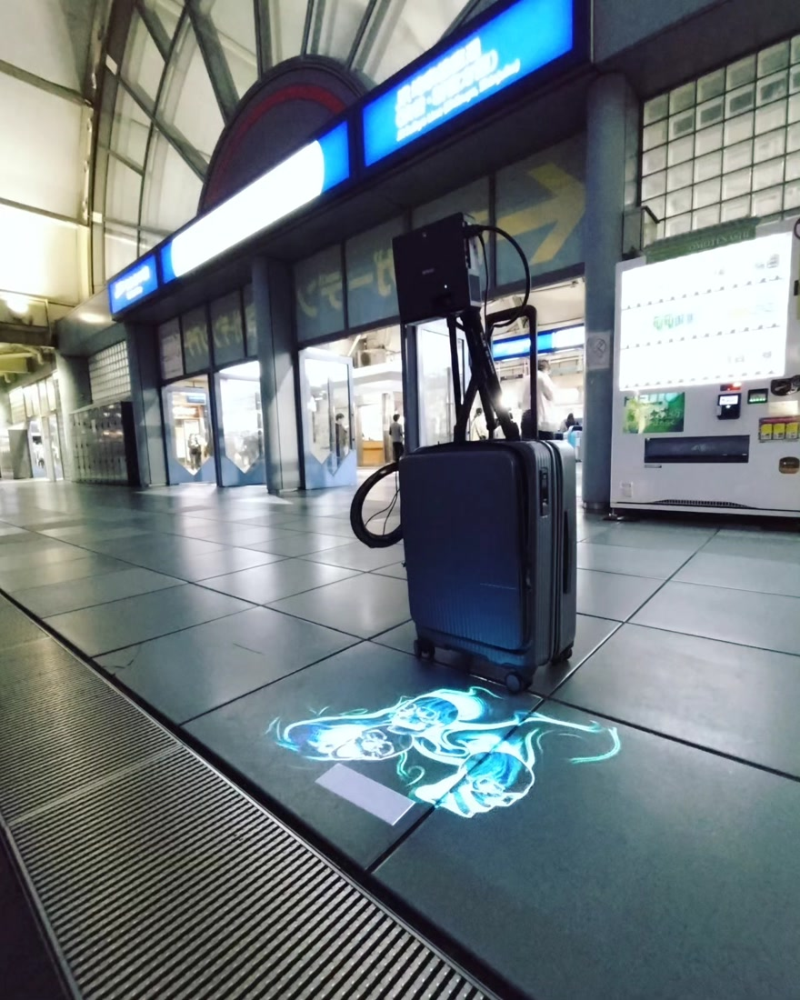
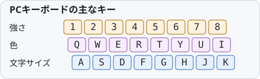

[English](README.en.md)

# キーボードで、壁や床をハロウィンに。

PCとプロジェクターで、壁や床にドクロやコウモリを投影。手元のキーボードで、動き・色・文字を変えられます。

*東京ビッグサイトでの投影例（旧TouchDesigner版）。配布ブラウザ版の実写ではありません。*

## キーボードひとつで、映像に変化を

*キーボードで投影映像を操る使用イメージ（図は説明用。実際の映像は下の画面例をご覧ください）。*

- **ドクロやコウモリを投影する** — 壁や床をハロウィンの風景に。
- **動きと色をその場で変える** — 雰囲気に合わせて、手元のキーで操作。
- **好きな文字を添える** — 挨拶やイベント名を映像に重ねる。

## 2種類の映像を切り替える

**Zキー**で、ドクロとコウモリを切り替えられます。

### ドクロ：それぞれ違う向きへ回転

動きを大きめにした実画面です。3体がそれぞれ違う向きに回転し、横顔や斜めからの形が見えます。

ドクロには、CDmir様の3Dモデル「[Human Skull](https://opengameart.org/content/human-skull-0)」を使用しています。公開してくださった作者様に感謝します。

### コウモリ：羽ばたきと色を変える

羽ばたくコウモリの動きや色を、投影しながら変えられます。上の2枚はブラウザ版の画面キャプチャです。

### キー操作の実演

約20秒・音声なし。ドクロの回転 → **Z**で切替 → コウモリの動きと**T / I**での色変更を、実際の速さで撮影しています。GIFは繰り返し再生します。[高画質のMP4を見る・保存する](docs/media/halloween-demo.mp4)。

## 使ってみる

ダウンロードと、投影を始める3手順

**配布用ZIPは準備中です。公開後、ここにダウンロードリンクを掲載します。**

<!-- RELEASE_DOWNLOAD_URL: 承認されたReleaseへ検証済み配布ZIPを添付してから、上の案内を実際のリンクへ差し替える。自動生成のSource code ZIPとは別。 -->

### 3手順で投影する

動作確認環境は **Windows・Chrome**。PCとプロジェクターの接続・画面配置は、先にWindows側で設定してください。追加ソフトやコマンド入力は不要です。

1. **ZIPをすべて展開する。** ZIPを右クリックして「すべて展開」。フォルダー全体を一緒に保持します。
2. **はじめにHTMLを開く。** 展開先の `はじめに_START-HERE.html` をChromeで開き、「映像をはじめる」を押します。
3. **投影を開始する。** 「投影窓を開く」→その窓を投影先へ移動→「ウィンドウで始める」または「全画面で始める」。操作画面へ戻って文字を準備し、「演奏開始」を押します。

操作画面と投影窓の両方を開いたまま使います。展開した一式があれば、ネット接続なしでも動作します。

## キーボードで操作する

「演奏開始」を押すとキーボード操作が有効になります。操作画面を選んだ状態のまま、半角英数・Shiftを押さずに使ってください。

| キー | 操作 |
| --- | --- |
| `1`〜`8` | 動きの激しさを8段階から選ぶ |
| `Q W E R T Y U I` | 色相を選ぶ |
| `A S D F G H J K` | 文字サイズを選ぶ |
| `Z` | ドクロ／コウモリを切り替える |
| `X` | 通常／左右反転／上下反転／上下左右反転 |
| `L` / `M` | 顎の開き幅を選ぶ／開閉する |
| `Space` | 映像全体の一時停止・再開 |
| `Esc` | キーボード操作を止める。映像は続く |

文字の内容は入力欄で編集します。ドクロは `9` / `0` で1〜6体、手動の顎は `C` で自動へ戻せます。全キーの説明は、展開先の `アプリ本体/GUIDE.html` にあります。

詳しい操作・困ったとき・終了

- 文字を入力したり、別のウィンドウへ切り替えるとキーボード操作が無効になります。日本語入力や修飾キーを使った後も、操作画面へ戻って「演奏開始」を押してください。
- 接続が切れたら「既存の投影窓へ再接続」。投影窓を閉じていたら、新しく開き直します。
- `N` を0.6秒長押しすると、文字と設定を保ったまま映像の動きをリセットします。保存しておいた見た目の設定へ戻すときは、`B` を0.6秒長押しします。
- 動きの強さを0%にするとドクロは定位置へ戻ります。コウモリは羽ばたきを続けるため、映像全体を止めるときは `Space` を押します。
- 終了は「投影の補正・中断・終了」→「投影を終了」。投影窓を閉じると文字・設定・基準は初期化されます。
- 画面の言語切替は案内文だけを変え、投影する文字は翻訳しません。

## 投影する前に

最初はプロジェクターの明るさを控えめにし、小さいウィンドウで試してください。投影光を人の目へ向けず、明るく変化する映像が苦手な人にも配慮してください。設置・排熱はプロジェクターの説明書に従います。

黒い部分の見え方や明るさは、プロジェクター・映す面・周囲の光で変わります。画面の自動配置・台形補正・スマホ操作には対応していません。実際に使うプロジェクターやPCで、事前に確認してください。

## 持ち運べる投影セットと組み合わせる

普段はPCとプロジェクターを机に置いて使えます。持ち出す場合には、スーツケース・ポータブル電源・三脚・プロジェクターを組み合わせ、屋外のパーティーやバンド演奏、ハロウィンイベントに映像を添える使い方もあります。スーツケースや専用の持ち運びセットは、アプリの利用に必須ではありません。

屋外では、十分な暗さと投影面、会場の許可、足元や機材の固定など、安全に設置できる条件を確認してください。

構成と作り方は、作者mamoの記事「[屋外プロジェクターを3分で設営する方法：ポータブルバッテリーと三脚で持ち運ぶ](https://qiita.com/moma42105016/items/85e66a60eb7b656c819c)」をご覧ください。

*持ち運べる投影セットを会場に設置して使うイメージです。組立手順や収納状態を示す図ではありません。*

## 利用条件と、自分用の変更

作者が作成したプログラム・コウモリ画像・動きや表示を再現するためのデータは **MITライセンス**です。CDmir様のドクロの3Dモデル「Human Skull」は **CC0 1.0** です。[LICENSE](LICENSE) と [素材ごとの利用条件](web/RIGHTS.txt)をご確認ください。

キーボード操作と持ち運び例は、このREADME向けに生成した説明用イラストです。冒頭の会場写真、ブラウザの画面キャプチャ、CDmir様の3Dモデルは、それぞれ別の素材です。会場写真と説明用イラストは、上記のMIT・CC0の対象には含めていません。

自分用に見た目や文章を変える方へ

ZIPには編集可能なHTML・CSS・JavaScriptが入っています。`アプリ本体/` の `console.html` / `console.css` は操作画面、`GUIDE.html` / `guide.css` は案内ページです。文章やスタイルの変更は、テキストを編集して再読込みすると確認できます。

画像の差し替えには、埋め込まれた画像データも一緒に更新する必要があります。詳しくは[編集案内](web/README.txt)をご覧ください。

GitHubの「Code → Download ZIP」はソース一式です。配布用ZIPとは構成が異なりますが、展開して一番上の `START-HERE.html` を開くと試せます。

